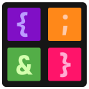
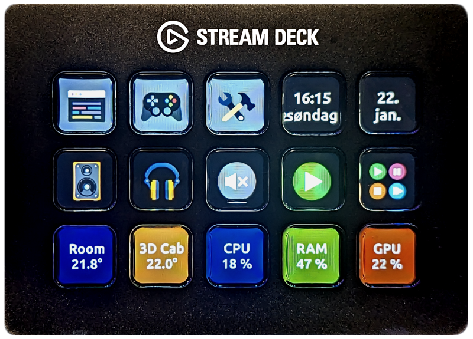
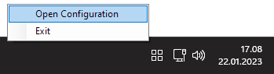

 

# Code Deck


## Description

**Code Deck** is a cross platform and open source alternative to the official Stream Deck application.

The `Code`-part of the name is a reference to how configuration and plugins work in **Code Deck**. Configuration uses `JSON`, and plugins are compiled `C#` projects.


*Picture of **Code Deck** running my configuration on my Stream Deck.*


## Table of Contents

- [Code Deck](#code-deck)
  - [Description](#description)
  - [Table of Contents](#table-of-contents)
  - [Features](#features)
  - [Concept](#concept)
    - [Key](#key)
    - [Page](#page)
    - [Profile](#profile)
    - [Tile](#tile)
    - [Plugin](#plugin)
  - [Graphical User Interface](#graphical-user-interface)
  - [Configuration](#configuration)
    - [Configuration File Structure](#configuration-file-structure)
      - [Stream Deck](#stream-deck)
      - [Plugin Settings](#plugin-settings)
      - [Profile](#profile-1)
      - [Page](#page-1)
      - [Key](#key-1)
  - [Image, Icons \& Emojis](#image-icons--emojis)
    - [Image](#image)
    - [Emojis](#emojis)
    - [Icon Fonts](#icon-fonts)
  - [Plugins](#plugins)
    - [List Of Built In Plugins \& Tiles](#list-of-built-in-plugins--tiles)
    - [Plugin Development](#plugin-development)
  - [Supported Stream Decks](#supported-stream-decks)
    - [Tested Stream Decks](#tested-stream-decks)
  - [Attributions](#attributions)
  - [Disclaimer](#disclaimer)


## Features
- Plugin Based Design
- File Based Configuration
- Cross Platform
- Unlimited Pages
- Multiple Profiles
- Lock Screen Profile
- Change Profile/Page Based On Running Program
- Highly Configurable
- Emoji Support


## Concept

**Code Deck** was made with *control* and *extensibility* as the primary goals. **Code Deck** strives to be light-weight, but that heavily depends on the users plugins and configuration.


### Key
- A single key on the Stream Deck.
- There are multiple key types:
  - `Normal`
    - Normal key that can be customized with the available settings.
      - May optionally be associated with a plugin and a tile.
      - May optionally navigate to another page.
  - `Back`
    - Navigates to the previous page.

### Page
- A page is a logical representation of a group of keys.
- A page can contain one or more keys.

### Profile
- A profile is a logical representation of a group of pages.
- There are multiple profile types:
  - `Normal`
  - `LockScreen`
    - **Code Deck** switches to this profile when the computer is locked.
      - Currently only supported on Windows 🪟.

### Tile
- A tile implements a piece of functionality.
- A tile can modify all properties of a key.
- A tile can react to key presses.

### Plugin
- A plugin can contain one or more tiles.
- Plugins are written in `C#`.
- Plugins are built as .NET assemblies and loaded when used by the configuration.
- All plugins can be modified by the user.


## Graphical User Interface
**Code Deck** *DOES NOT* have a graphical user interface for configuration.

Windows users may use `CodeDeck.Windows.exe` which adds an icon to the notification area on the taskbar. The icon has a context menu with easy access to the configuration file and a way to easily exit **Code Deck**.

The tray menu also provides **Show Debug Log** / **Hide Debug Log**. The native
console stays attached and continues collecting logs while hidden, preserving
its scrollback. Its Close command (including the X button and normal Alt+F4
closing) is disabled; use the tray menu to hide it and **Exit** to stop Code Deck.
Launch `CodeDeck.Windows.exe --debug` to show it automatically on startup. It is
also shown automatically when a debugger is attached.

This requires classic **Windows Console Host**, not Windows Terminal's
pseudoconsole. A dedicated console is allocated at startup even when initially
hidden; an inherited console is detached rather than modified.
If console setup fails, Code Deck continues running without it and disables the
debug-log menu item. An explicitly requested debug console also shows a warning.
This prevents normal console-window closing from stopping the application, but
does not prevent termination through Task Manager or console control signals.

**Plugin Tasks...** shows loaded plugins and their managed tasks, including the
last update time and error. Plugins and tiles log through the host's `ILogger`
pipeline; errors include exception details in the debug log. Recurring tasks retry
at their configured interval after an update fails. Hiding the log does not
disable logging.




## Configuration
**Code Deck** is configured using a single `JSON`-file. The configuration file must be located in your user folder. If no configuration file exists, a default configuration will be created on startup. Changes to the configuration are automatically applied.

Full path to configuration file:
- 🪟 Windows
  - `C:\Users\{username}\.codedeck\deck.json`

- 🐧 Linux
  - `~/.codedeck/deck.json`
  - `/home/{username}/.codedeck/deck.json`


### Configuration File Structure

```json
{
  // Stream Deck
  "Brightness": 100,

  // Plugin settings
  "Plugins": [
    {
      "Name": "NissanConnect",
      "Settings": {
        "Email": "",
        "Password": ""
      }
    },
  ],

  // Profiles
  "Profiles": [
    {
      // Profile
      "Name": "DefaultProfile",
      "Pages": [
        {
          // Page
          "Name": "DefaultPage",
          "Keys": [
            {
              // Key
              "Index": 1,
              "Text": "CODE"
            },
            // More Keys ...
          ]
        },
        // More Pages ...
      ]
    },
    // More Profiles ...
  ]
}
```

#### Stream Deck

```json
{
  "DevicePath": null,
  "Brightness": 100,
  "FallbackFont": "Twemoji Mozilla",
  "Profiles": []
}
```

| Field        | Values            | Description                                                                                                              |
| ------------ | ----------------- | ------------------------------------------------------------------------------------------------------------------------ |
| DevicePath   | `null`            | Path to a specific device, can be used in the case of multiple connected devices.                                        |
| Brightness   | `100`             | Brightness in percent.                                                                                                   |
| FallbackFont | `Twemoji Mozilla` | Font to use if a glyph is not available in the `Key`-font. Set this to an emoji or icon font to easily use icons/emojis. |
| Profiles     | `Profile[]`       | An array of `Profile` objects.                                                                                           |


#### Plugin Settings
Plugins can have settings that are specific to the plugin and accessible from all tiles in the plugin. Settings are specified in the top level `Plugins`-array. Each plugin has a `Name` and a `Settings`-object.

```json
// Plugin settings
"Plugins": [
  {
    "Name": "NissanConnect",
    "Settings": {
      "Email": "",
      "Password": ""
    }
  },
],
```

Use the `[Setting]` attribute on properties in the plugin class to automatically bind the settings to the property.

```csharp
    public class NissanConnect : CodeDeckPlugin
    {
        [Setting] public static string? Email { get; set; }
        [Setting] public static string? Password { get; set; }
    }
```


#### Profile

```json
{
  "Name": "DefaultProfile",
  "ProfileType": "Normal",
  "Pages": []
}
```

| Field       | Values                        | Description                 |
| ----------- | ----------------------------- | --------------------------- |
| ProfileType | `"Normal"` \| `"LockScreen"*` | Profile type.               |
| Name        | `DefaultProfile`              | Name of the profile.        |
| Pages       | `Page[]`                      | An array of `Page` objects. |

`*"LockScreen"` is only supported on Windows for now. If a profile of this type exists, **Code Deck** will automatically change to that profile when the computer is locked.


#### Page

```json
{
  "Name": "DefaultPage",
  "Pages": []
}
```

| Field | Values           | Description                 |
| ----- | ---------------- | --------------------------- |
| Name  | `DefaultProfile` | Name of the profile.        |
| Keys  | `Key[]`          | An array of `Page` objects. |


#### Key

```json
{
  "Index": 0,
  "KeyType": "Normal",
  "Profile": null,
  "Page": null,
  "Plugin": "Clock",
  "Tile": "DigitalClockTile",
  "DisableTilePress": false,
  "Text": "Clock",
  "TextColor": "#ffffff",
  "TextOffsetX": 0,
  "TextOffsetY": 0,
  "LineSpacing": 0.0,
  "Font": "Ubuntu",
  "FontSize": 18,
  "FontBold": false,
  "FontItalic": false,
  "BackgroundColor": "#000000",
  "Image": "image.png",
  "DisableTileImage": true,
  "ImagePadding": 5,
  "ImageOffsetX": 0,
  "ImageOffsetY": 0,
  "ShowFolderIndicator": false,
  "FolderIndicatorColor": "#ff0000",
  "ActivityIndicatorColor": "#00ff00",
  "Settings": {
    "Format": "dd.\nMMM",
    "Interval": "60000"
  }
}
```

| Field                  | Example Values            | Description                                                                                                                                                               |
| ---------------------- | ------------------------- | ------------------------------------------------------------------------------------------------------------------------------------------------------------------------- |
| Index                  | `0` ... `X`               | Index of the key on the Stream Deck. `X` = number of keys - `1`.                                                                                                          |
| KeyType                | `"Normal"` \| `"Back"`    | The type of key. Default is `"Normal"`. `"Back"` is a key that navigates backwards.                                                                                       |
| Profile                | `"ProfileName"`           | The name of the `Profile` that contains the `Page` to navigate to.                                                                                                        |
| Page                   | `"PageName"`              | The name of the `Page` to navigate to.                                                                                                                                    |
| Plugin                 | `"PluginName"`            | The name of the `Plugin` to associate with this key.                                                                                                                      |
| Tile                   | `"TileName"`              | The name of the `Tile` to associate with this key.                                                                                                                        |
| DisableTilePress       | `true` \| `false`         | Setting this to `true` disables the tile press action, useful when using a Tile to open a page, but you don't want the Tile press action to be ran when opening the page. |
| Text                   | `"Some Text"`             | The text to show on the key. Text is always centered. Use `\n` for multiple lines.                                                                                        |
| TextColor              | `"#ffffff"`               | Color of the `Text`.                                                                                                                                                      |
| TextOffsetX            | `0`                       | The offset to add to the X-position of the text.                                                                                                                          |
| TextOffsetY            | `-5`                      | The offset to add to the Y-position of the text.                                                                                                                          |
| LineSpacing            | `1.0`                     | Spacing between lines. Value is in percent of the line height. `1.1` means the spacing is 10% more than the line height.                                                  |
| Font                   | `"Font Name"`             | Name of the font to use for the `Text`.                                                                                                                                   |
| FontSize               | `10`                      | Size of the `Font`.                                                                                                                                                       |
| FontBold               | `true` \| `false`         |                                                                                                                                                                           |
| FontItalic             | `true` \| `false`         |                                                                                                                                                                           |
| BackgroundColor        | `"#000000"`               | Color of the background color of the key.                                                                                                                                 |
| Image                  | `filename.png`            | Path to an image file. The image will be shown on the key.                                                                                                                |
| DisableTileImage       | `true` \| `false`         | Setting this to `true` disables any image set by a Plugin Tile.                                                                                                           |
| ImagePadding           | `5`                       | A padding to apply to the image. Very useful when trying to match all image sizes.                                                                                        |
| ImageOffsetX           | `0`                       | The offset to add to the X-position of the image.                                                                                                                         |
| ImageOffsetY           | `-5`                      | The offset to add to the Y-position of the image.                                                                                                                         |
| ShowFolderIndicator    | `true` \| `false`         | An optional indicator to show on keys with `KeyType` = `Page`. The indicator is a line at the bottom of the key.                                                          |
| FolderIndicatorColor   | `"#cccccc"`               |                                                                                                                                                                           |
| ActivityIndicatorColor | `"#ffff00"`               | Color of the activity indicator. Some plugins may show this indicator while doing some task. The indicator is a small circle in the top right corner.                     |
| Settings               | `{ "Key": "Value", ... }` | A key/value dictionary containing the settings needed to configure the `Tile`. All values ***MUST*** be `string`s.                                                        |

All fields are optional except for `Index`.


## Image, Icons & Emojis

### Image
The `Key.Image` field can be set to the path of an image file. The image will be drawn to key. Supported formats are listed [here](https://docs.sixlabors.com/articles/imagesharp/imageformats.html).


### Emojis

As an alternative to supplying an image, you can use emojis. **Code Deck** has built in support for emojis through the bundled Twemoji Mozilla font ([`Twemoji.Mozilla.ttf`](https://github.com/mozilla/twemoji-colr)).

Use the `Text` field to specify one or more emojis. Adjust the `FontSize` field for a bigger *"icon"*.

Example:
```json
{
  "Text": "🔒",
  "FontSize": 50
}
```

You can also use other third party emoji fonts. The font must support the `COLR`-format. The `COLR`-format is the only format currently supported by `SixLabors.Fonts` which is the font library **Code Deck** uses.

On Windows you can use [`Segoe UI Emoji`](https://learn.microsoft.com/en-us/typography/font-list/segoe-ui-emoji) for example.

***⚠️ Some of the most known Emoji fonts DO NOT support the `COLR`-format and will not work with Code Deck. A few known examples are listed below:***

- Noto Color Emoji
- OpenMoji

### Icon Fonts

[`Segoe Fluent Icons`](https://learn.microsoft.com/en-us/windows/apps/design/style/segoe-fluent-icons-font) is another option on Windows.

This font contains a ***lot*** of glyphs. These glyphs can be combined with the `TextColor` field like a normal font.

There are multiple third party icon fonts that should work in the same way.

All glyphs and their unicode value is listed [here](https://learn.microsoft.com/en-us/windows/apps/design/style/segoe-fluent-icons-font). Prefix the unicode value with `\u` in the `JSON`-configuration.

Example:
```json
{
  "Text": "\ue72e",
  "TextColor": "#ff0000",
  "Font": "Segoe Fluent Icons",
  "FontSize": 50
}
```


## Plugins

**Code Deck** has a powerful, but easy to use plugin system.

Plugins are located in the `Plugins` directory beside the host executable. Each
plugin has its own subdirectory containing its compiled assembly, dependency
manifest, dependencies, and assets. Only plugins referenced by the configuration
(including plugin-level settings) are loaded.

Build either host project to stage all built-in plugins. `dotnet publish` also
includes the complete `Plugins` directory; deploy the whole output, not just the
host executable. Changes to plugin assemblies or assets trigger a reload from a
shadow copy. Existing tiles are cancelled and deinitialized before the previous
plugin's tasks and shared resources are released.

Documentation for each plugin can be found as a markdown file in each plugins directory. The below table links directly to each plugins documentation.

### List Of Built In Plugins & Tiles

| Name                               | Tile                                                                                                                                                             | OS Support | Description                 |
| ---------------------------------- | ---------------------------------------------------------------------------------------------------------------------------------------------------------------- | ---------- | --------------------------- |
| AudioDeviceSwitcher                | AudioDeviceSwitcherTile                                                                                                                                          | 🪟          |                             |
| Clock                              | [DigitalClockTile](CodeDeck.Plugins/Plugins/Clock/Clock.md)                                                                                                      | 🪟🐧         |                             |
|                                    | [StopWatchTile](CodeDeck.Plugins/Plugins/Clock/Clock.md#stopwatchtile)                                                                                           | 🪟🐧         |                             |
| Counter                            | [CounterTile](CodeDeck.Plugins/Plugins/Counter/Counter.md)                                                                                                       | 🪟🐧         |                             |
| CounterStrikeGlobalOffensiveNetCon | [ExecuteCommand](CodeDeck.Plugins/Plugins/CounterStrikeGlobalOffensiveNetCon/README.md)                                                                          | 🪟🐧*        | *Linux support is untested. |
| HyperXCloudFlightWireless          | [BatteryTile](CodeDeck.Plugins/Plugins/HyperXCloudFlightWireless/README.md)                                                                                      | 🪟🐧*        | *Linux support is untested. |
| HyperXCloudAlphaWireless           | [BatteryTile](CodeDeck.Plugins/Plugins/HyperXCloudAlphaWireless/README.md)                                                                                       | 🪟🐧*        | *Linux support is untested. |
| Lock                               | [LockTile](CodeDeck.Plugins/Plugins/Lock/Lock.md)                                                                                                                | 🪟          |                             |
| LogitechG703                       | This plugin is deprecated. Use the [G703BatteryTile](CodeDeck.Plugins/Plugins/LogitechMice/README.md#g703batterytile) tile from the LogitechMice plugin instead. | 🪟🐧*        | *Linux support is untested. |
| LogitechMice                       | [G703BatteryTile](CodeDeck.Plugins/Plugins/LogitechMice/README.md#g703batterytile)                                                                               | 🪟🐧*        | *Linux support is untested. |
|                                    | [GProXSuperlightBatteryTile](CodeDeck.Plugins/Plugins/LogitechMice/README.md#gproxsuperlightbatterytile)                                                         | 🪟🐧*        | *Linux support is untested. |
| MediaKeys                          | MuteTile                                                                                                                                                         | 🪟          |                             |
|                                    | VolumeDownTile                                                                                                                                                   | 🪟          |                             |
|                                    | VolumeUpTile                                                                                                                                                     | 🪟          |                             |
|                                    | NextTrackTile                                                                                                                                                    | 🪟          |                             |
|                                    | PreviousTrackTile                                                                                                                                                | 🪟          |                             |
|                                    | StopTile                                                                                                                                                         | 🪟          |                             |
|                                    | PlayPauseTile                                                                                                                                                    | 🪟          |                             |
| NetworkTools                       | [ExternalIpTile](CodeDeck.Plugins/Plugins/NetworkTools/README.md)                                                                                                | 🪟🐧         |                             |
| NissanConnect                      | [NissanConnectBatteryLevelTile](CodeDeck.Plugins/Plugins/NissanConnect/README.md#nissanconnectbatteryleveltile)                                                  | 🪟🐧         |                             |
|                                    | [NissanConnectRangeTile](CodeDeck.Plugins/Plugins/NissanConnect/README.md#nissanconnectrangetile)                                                                | 🪟🐧         |                             |
|                                    | [NissanConnectChargeStatus](CodeDeck.Plugins/Plugins/NissanConnect/README.md#nissanconnectchargestatus)                                                          | 🪟🐧         |                             |
|                                    | [NissanConnectBatteryStatusAge](CodeDeck.Plugins/Plugins/NissanConnect/README.md#nissanconnectbatterystatusage)                                                  | 🪟🐧         |                             |
| HardwarePerformance                | [CpuUsageTile](CodeDeck.Plugins/Plugins/HardwarePerformance/README.md#cpuusagetile)                                                                              | 🪟          |                             |
|                                    | [MemoryUsageTile](CodeDeck.Plugins/Plugins/HardwarePerformance/README.md#memoryusagetile)                                                                        | 🪟          |                             |
|                                    | [GpuUsageTile](CodeDeck.Plugins/Plugins/HardwarePerformance/README.md#gpuusagetile)                                                                              | 🪟          |                             |
| PerformanceCounters                | [CpuUsageTile](CodeDeck.Plugins/Plugins/PerformanceCounters/README.md#cpuusagetile)                                                                              | 🪟          |                             |
|                                    | [MemoryUsageTile](CodeDeck.Plugins/Plugins/PerformanceCounters/README.md#memoryusagetile)                                                                        | 🪟          |                             |
|                                    | [GpuUsageTile](CodeDeck.Plugins/Plugins/PerformanceCounters/README.md#gpuusagetile)                                                                              | 🪟          |                             |
| Runner                             | [RunTile](CodeDeck.Plugins/Plugins/Runner/Runner.md#runtile)                                                                                                     | 🪟🐧         |                             |
|                                    | [OpenWebsiteTile](CodeDeck.Plugins/Plugins/Runner/Runner.md#openwebsitetile)                                                                                     | 🪟🐧         |                             |
| SteelSeriesRival3Wireless          | [BatteryTile](CodeDeck.Plugins/Plugins/SteelSeriesRival3Wireless/README.md)                                                                                      | 🪟🐧*        | *Linux support is untested. |
| Template                           | TemplateTileOne                                                                                                                                                  | 🪟🐧         |                             |
|                                    | TemplateTileTwo                                                                                                                                                  | 🪟🐧         |                             |
| KeyboardSimulator                  | TyperTile                                                                                                                                                        | 🪟          |                             |
|                                    | HotkeyTile                                                                                                                                                       | 🪟          |                             |
| Weather                            | [YrImageTile](CodeDeck.Plugins/Plugins/Weather/Weather.md#yrimagetile)                                                                                           | 🪟🐧         |                             |
| WebRequest                         | [PlainTextTile](CodeDeck.Plugins/Plugins/WebRequest/WebRequest.md)                                                                                               | 🪟🐧         |                             |
|                                    | [ImageTile](CodeDeck.Plugins/Plugins/WebRequest/WebRequest.md#imagetile)                                                                                         | 🪟🐧         |                             |


### Plugin Development
Read about plugin development [here!](CodeDeck.Plugins/Plugins/)

### Development checks

Run the hardware-independent regression tests with:

```sh
dotnet test CodeDeck.Tests/CodeDeck.Tests.csproj -c Release
```

The tests cover tile initialization and teardown, cancellation, image ownership,
HTTP recovery, and plugin replacement. Windows console behavior and real HID
devices still require a hardware smoke test.

SixLabors dependencies remain on ImageSharp 3.1.12, Drawing 2.1.7, and Fonts 2.1.3.
NuGet reports known advisories for ImageSharp; these are not suppressed. Newer
releases require a license key even for eligible open-source/hobby projects.
A free assembly-scoped Community key can be requested at
https://licensing.sixlabors.com/. Until one is configured, keep these buildable
versions rather than disabling license validation. Other dependencies are updated
independently; the NissanConnect 2.0 migration remains on its separate branch.


## Supported Stream Decks

**Code Deck** *should* work with any Stream Deck hardware supported by [`OpenMacroBoard` & `StreamDeckSharp`](https://github.com/OpenMacroBoard/StreamDeckSharp).

### Tested Stream Decks

| Stream Deck Hardware          | Status   | Notes                                                                                                                 |
| ----------------------------- | -------- | --------------------------------------------------------------------------------------------------------------------- |
| Stream Deck Mini              | Untested |                                                                                                                       |
| Stream Deck (Standard) (MK.1) | ✔️        |                                                                                                                       |
| Stream Deck (Standard) (MK.2) | Untested |                                                                                                                       |
| Stream Deck +                 | Untested | Stream Deck + has an additional screen (or screen area at least) and rotary knobs. The "standard" buttons might work. |
| Stream Deck XL                | Untested |                                                                                                                       |


## Attributions

**Code Deck** makes heavy use of the following great libraries:
- [StreamDeckSharp](https://github.com/OpenMacroBoard/StreamDeckSharp)
- [ImageSharp](https://github.com/SixLabors/ImageSharp)

**Code Deck** uses the following font for built in emoji support:
- [Twitter Emoji (Twemoji)](https://github.com/twitter/twemoji)
- [Twemoji Mozilla (Twemoji font in COLR/CPAL layered format)](https://github.com/mozilla/twemoji-colr)


## Disclaimer
**Code Deck** is not endorsed by, directly affiliated with, maintained, authorized, or sponsored by Elgato. All product and company names are the registered trademarks of their original owners. The use of any trade name or trademark is for identification and reference purposes only and does not imply any association with the trademark holder of their product brand.
